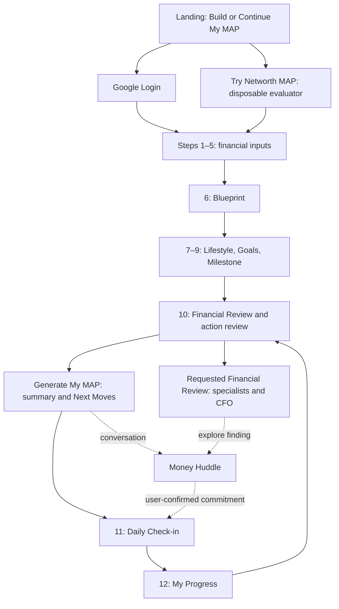

# Networth MAP — Design specification

**GrowthX Build Sprint · Shaktimaan design submission · 11 October 2026**  
Product: Networth MAP and Money Huddle. Status: implemented experience, with evidence boundaries and proposed improvements explicitly identified.

## 1. Executive design overview

**Evaluator follow-up:** the builder reports that GrowthX accepted this design at 300 points. The additions below preserve the accepted journey and evidence; the score is user-reported, not independently verified. External references, first-screen copy and the unified typography specification are documentation proposals, not published UI changes.

Networth MAP helps a person organise their financial picture, connect it to the life they want, and choose a next step. Money Huddle provides one continuing coaching surface beside that picture. The experience moves from **Blueprint → Vision → MAP → voluntary action → reported outcome → reflection**.

The core transformation is from scattered figures and vague aspirations to a readable financial picture and a deliberate choice. Wealth, spendable cash, annual surplus and a reported result are kept distinct. A complete form is not an independently verified financial position.

The design combines a guided twelve-step journey, calculations performed by code, evidence-checked Financial Review, and coaching anchored to saved information. This is an implemented combination, not a proven competitive advantage. No real-user research, measured comprehension improvement or model superiority is claimed.

This document owns screen behaviour and design rationale. [PRODUCT.md](PRODUCT.md) owns strategy and commercial hypotheses; [TECH.md](TECH.md) owns technical contracts. Their older release/test paragraphs are historical snapshots; section 16 cites newer production evidence. The [previous DESIGN.md](docs/reference/DESIGN_2026-10-10.md) is preserved as reference. No application code or deployment is changed by this document.

**Evidence key:** **Implemented** means traceable to current source. **Observed** means recorded on a named release or test environment. **Proposed** means not implemented or not established. Design rationales below explain the existing choices; they do not imply research participants endorsed them.

## 2. Target users

The primary product hypothesis is Indian business owners and founders seeking clarity about their personal finances. Professionals and salaried people are supported secondary profiles. The actual profile buttons are **Founders, Business Owners, Professionals, Salaried**; there is no dedicated retiree profile or financial-literacy questionnaire.

| Intended user | Likely task and design response | Evidence boundary |
|---|---|---|
| Business owner or founder | Separate personal receipts from business turnover; understand personally borne debt and equity value. Contextual income wording and ownership guidance support this. | Implemented forms; demand and comprehension unvalidated. |
| Salaried person or professional | Understand take-home income, recurring costs and cash remaining; connect them to a goal. | Implemented forms and synthetic examples, not customer outcomes. |
| Person with uncertain or irregular finances | State what is known, estimated or missing before discussing a decision. | Uncertainty exists in saved context and Coach; ordinary form controls are less flexible. |
| Returning user | Recover saved facts, revisit a chosen action and record what happened. | Saved MAP and check-in history; raw chat transcript is not restored. |

Financial literacy may vary widely; headings ask everyday questions before displaying financial terms. The app does not assess literacy and adapt a personalised curriculum. Motivations and pain points are product hypotheses, not invented interview findings.

Jobs to be done:

- “Help me understand what I own, owe and have left each year.”
- “Help me connect those facts to the life and goals I care about.”
- “Help me compare a manageable next step without deciding for me.”
- “Help me remember what I chose and reflect on the actual result.”

## 3. Design principles

| Principle | Implemented expression | Limit or design implication |
|---|---|---|
| Clarity before complexity | One financial domain per assessment screen; Blueprint consolidates the picture. | Twelve destinations still create effort; completion time is unmeasured. |
| Unknown is not zero | Blank/unknown dependencies withhold calculated values; explicit ₹0 is valid. | Some blank inputs pass Next but later reduce full-picture completeness. |
| Accuracy before persuasion | Code owns calculations; mismatched Coach figures are rejected. | Verification can reject useful prose; it is not proof of every semantic claim. |
| Coaching over prescribing | Questions, trade-offs and voluntary commitments; no automated transactions. | Live behavioural quality needs broader evaluation. |
| Evidence before recommendation | Review evidence/formulas are expandable; current saved actions anchor Top 3 answers. | Insufficient analysis may yield few or no useful insights. |
| User agency and privacy | Confirmation for important proposed updates; export/delete controls; separate evaluator sessions. | App deletion does not control provider copies or remove a normal authentication identity. |
| Progressive disclosure | Add only relevant assets/debts; details and evidence expand on demand. | Full assessment still requires profile, spending, vision and goals. |
| Accessible, small-screen interaction | Responsive layouts, named controls, visible focus, sticky navigation. | Screen-reader, contrast and physical-device certification remain unverified. |

## 4. Information architecture

The diagram describes destinations, not automatic AI calls. **Generate My MAP** produces the assessment result and rule-based Next Moves. **Explore this question** and **Review my full MAP** explicitly request AI analysis. Personal CFO is the synthesis behind Financial Review, not a second chat or separate navigation destination.

The generated MAP is a result inside the original assessment, not an extra thirteenth step. The wrapper adds Daily Check-in and My Progress as steps 11 and 12. Navigation uses shorter labels: Profile, Assets, Liabilities, Spending, Investing, Plan, Vision, Goals, Milestone, Review, Check-in, Progress. `/demo` currently routes to the normal application rather than a guaranteed scripted tour.

Returning Google accounts resume saved context. `/try` has separate disposable credentials and a visible evaluator notice. Closed, expired or exhausted evaluator access is explained; it is not converted silently into permanent storage.

Source: [assessment](src/original-map/networth-assessment.tsx), [journey wrapper](src/NetworthMap.jsx), [workspace](src/App.jsx), [route entry](src/route-entry.mjs).

### First-screen copy specification — proposed, not applied

**Screen:** signed-out landing page, before the assessment or Google sign-in. Keep the approved Blueprint → Vision → MAP explanation below this opening; do not add extra onboarding steps. These strings are exact proposed copy, not a claim that the current landing already displays them.

| Element | Exact copy | Existing flow to preserve |
|---|---|---|
| Headline | **Understand your money. Choose your next move.** | One main heading; does not promise a financial outcome. |
| Supporting copy | Bring together what you earn, own, owe, spend and invest. Connect your financial picture to the life you want, then use Money Huddle to think through your next step. | Describes the current manually entered MAP and optional Coach. |
| Primary CTA | **Continue with Google** | Use the existing Google sign-in flow, then open or resume the MAP. |
| Secondary CTA | **Try Networth MAP** | Use the existing disposable evaluator flow only when enabled and admission is available. |
| Trust line | You enter the figures. No bank connection is required. Your saved MAP belongs to your signed-in account. | No assertion that balances are independently verified. |
| AI disclosure | AI features send relevant financial information to external AI providers. You choose whether to request a Financial Review or message Money Huddle. | Does not promise zero provider retention or end-to-end encryption. |
| Financial boundary | Educational guidance based on the information you provide. Not investment, tax or legal advice, and no guarantee of financial outcomes. | Retains the existing safety boundary. |
| Evaluator note, beside secondary CTA | Use synthetic information for evaluation. The disposable session lasts up to four hours; its records are scheduled for deletion after it ends. Voice and email contact require Google Login. | Expiry can occur earlier at the evaluation deadline; cleanup is scheduled, not instantaneous. |

For an already signed-in returning account, the primary CTA is **Continue My MAP** and skips a new sign-in. Hide the evaluator CTA when access is disabled; when availability is unknown or exhausted, use the existing server explanation rather than claiming access is available. Do not add a completion-time claim, privacy certification, testimonial, guaranteed insight count or score badge to this opening.

## 5. Complete twelve-step user journey

The names below match the implemented step names and wrapper labels. Every step uses the common navigation and save behaviour in section 12. Validation establishes usable supplied data, not external truth.

### 1 · Personal Profiling — navigation: Profile

**Objective and inputs:** identify primary earning context; enter annual personal income before tax and effective tax percentage. **Interaction:** choose one of four profiles; use labelled amount/rate controls. Business wording includes salary, drawings, dividends and regular withdrawals, excluding business revenue. **Validation:** profile, non-negative income (including explicit zero), and tax from 0–100% are required. **Calculation:** show after-tax income from supplied gross income and tax. **Navigation:** Add My Assets after validation; returning incomplete profiles resume here. **Empty/error recovery:** required choice/field messages and focus guide correction. **Understanding:** personal income, business turnover and take-home income are different.

### 2 · Own — navigation: Assets

**Objective and inputs:** record personally relevant assets by category, current value, description, annual net income and Primary Use. **Interaction:** add/edit/remove asset rows; select Investments or Personal / Lifestyle. Business ownership guidance prevents counting underlying business assets again. **Validation:** each added value and Primary Use are required; non-empty annual income must be valid. **Calculation:** supported total assets, live net-worth preview and asset-income yield where inputs support it. **Navigation:** Add My Liabilities. **Empty/error recovery:** category buttons invite the first asset; missing Primary Use shows “Choose Investments or Personal / Lifestyle for this asset to complete your MAP” and failed Next focuses the first option, Investments. **Understanding:** an investment purpose does not make cash an annual income stream.

**Known gap:** an empty asset list can pass form Next but does not establish zero assets. Blank annual net income can also pass Next while the full-picture check still needs it. Description is optional. These inconsistencies are documented, not described as corrected by the Primary Use fix.

### 3 · Owe — navigation: Liabilities

**Objective and inputs:** record each personally borne debt: type, description, outstanding balance, optional interest rate/annual repayment, classification and whether repayment is already included in household Needs. **Interaction:** add/remove rows or explicitly confirm no liabilities. **Validation:** balance required; supplied rate must be 0–100%; no-debt declaration needed for an empty collection. **Calculation:** supported debt total, estimated annual interest and repayment treatment. **Navigation:** Add My Expenses. **Empty/error recovery:** add a debt or confirm none; contradictory included repayments produce a warning. Blank optional rate/repayment can reduce full-picture completeness. **Understanding:** outstanding principal, interest estimate and annual repayment are different; personally borne business debt matters.

### 4 · Spend — navigation: Spending

**Objective and inputs:** enter monthly essential Needs and discretionary Wants. **Interaction:** two currency fields with amount guidance. **Validation:** both amounts required, non-negative; ₹0 only when explicitly supplied. **Calculation:** monthly amounts ×12 for annual household costs. **Navigation:** Add My Investments. **Empty/error recovery:** blanks are identified rather than treated as zero; fix the input and retry. **Understanding:** these are recurring monthly costs; loan repayment included here must not be deducted again.

### 5 · Invest — navigation: Investing

**Objective and inputs:** state current annual investing contributions. **Interaction:** annual amount control and supported remaining-cash view. **Validation:** amount or explicit zero required. **Calculation:** annual surplus minus annual investing, when dependencies are available. **Navigation:** Review My Financial Plan. **Empty/error recovery:** blank investing prompts an explicit amount; missing upstream information suppresses dependent conclusions. **Understanding:** contributions are a flow, portfolio value is a balance, and cash after investing is not the current bank balance.

### 6 · Blueprint — navigation: Plan

**Objective and inputs:** review the existing financial picture; no separate compulsory input set. **Interaction:** metric cards, breakdowns and edit routes to source sections. **Validation:** supported financial readiness governs the detailed Blueprint; reaching this screen alone does not prove readiness. **Calculation:** balances, take-home, household costs, repayment-aware surplus and investing remainder; selected ratios where supported. **Navigation:** Define My Vision; edit/back links correct earlier entries. **Empty/error recovery:** an incomplete-picture panel names sections and exposes independently supported metrics. **Understanding:** a coherent picture should explain where each result came from, including unavailable values and estimates.

### 7 · Lifestyle — navigation: Vision

**Objective and inputs:** choose Financial Security, Financial Independence or Financial Freedom; optionally record recurring lifestyle changes and their start dates. Freedom can use a desired monthly lifestyle amount. **Interaction:** vision cards and add/remove change controls. **Validation:** explicit vision choice; added changes need valid positive amounts and supported dates; unknown required vision dependencies affect completion. **Calculation:** Security uses essential costs, Independence current household lifestyle, and Freedom its supplied baseline/changes; annualised increases/decreases adjust the selected cost. **Navigation:** Define My Goals. **Empty/error recovery:** highlight missing vision or incomplete change fields; remove an unfinished change if it is not intended. **Understanding:** the result is a lifestyle-cost target, not proof that financial independence has been achieved.

### 8 · Goals — navigation: Goals

**Objective and inputs:** choose specific goal categories and amounts, with supporting description, importance and optional target year. **Interaction:** select categories and edit corresponding details. **Validation:** at least one goal and a positive amount for each selected goal; a supplied year must be future and within the supported range. **Calculation:** supported goal totals/gaps inform the picture; missing optional timing is not invented. **Navigation:** Set My Wealth Milestone. **Empty/error recovery:** invite a first goal, identify its missing amount/year, or remove an unintended selection. **Understanding:** a labelled goal with an amount is more concrete than a vague aspiration; the app does not resolve competing priorities for the user.

### 9 · Milestone — navigation: Milestone

**Objective and inputs:** decide whether to put a number on the wealth aspiration; optionally supply target net worth and future year; describe purpose/motivation. **Interaction:** yes/Not yet choice and conditional fields. **Validation:** explicit choice required; yes requires a positive target and future year. Current UI does not mandate the legacy age fields. **Calculation:** supported target comparison; Not yet does not become a numeric zero target. **Navigation:** Review My Actions. **Empty/error recovery:** choose Not yet legitimately, or complete the highlighted milestone fields. **Understanding:** uncertainty about a target is acceptable; a target is not a guaranteed forecast.

### 10 · Financial Review — navigation: Review

**Objective and inputs:** examine voluntary proposed actions and optionally ask an analysis question. **Interaction:** add/edit/remove actions, Explore this question, Review my full MAP, Generate My MAP. **Validation:** an entered action requires category and description; no action is required. AI review controls are disabled during relevant pending edits/saves. **Calculation:** generated Next Moves derive from supported assessment findings; AI review uses the verified financial picture. **Navigation:** Generate opens the MAP result; earlier steps remain available for correction; complete assessment enables Check-in/Progress. **Empty/error recovery:** no actions is valid; remove unfinished rows, retry AI errors, or complete missing sections. **Understanding:** a proposed action, an AI insight and an active chosen commitment are separate things.

### 11 · Daily Check-in — navigation: Check-in

**Objective and inputs:** report an action, why it matters, date, Completed/Made progress/Not done yet, what changed, optional obstacle and optional realised financial result. **Interaction:** reuse the active commitment or record a different action; explicitly confirm the report (and MAP snapshot when needed). **Validation:** valid non-future date, action/goal context and narrative; selected monetary result needs an explicit non-negative amount; confirmation required. **Calculation:** supported MAP total assets can provide a disclosed snapshot; execution never automatically changes balances. **Navigation:** Save My Check-in opens Progress; Money Huddle offers reflection. **Empty/error recovery:** no active action means entering one; failed save retains words. **Understanding:** completion, financial impact and changed net worth are distinct. The default status is Completed; whether that biases novices is unvalidated.

### 12 · My Progress — navigation: Progress

**Objective and inputs:** revisit recorded follow-through; no compulsory new inputs. **Interaction:** journal, loaded completed/partial counts, current MAP net worth, fourteen-day completed-check-in bars, latest reported amount, Load earlier progress and embedded Financial Review. **Validation:** available when assessment completion permits it; financial values use supported metrics. **Calculation:** counts derive from loaded records; chart counts actions, not wealth gained. **Navigation:** Record My Check-in or return to Review. **Empty/error recovery:** “Your first check-in will start your progress story”; unavailable net worth says Not enough data; missing realised results say no amount reported. **Understanding:** unreported days are not failure, and self-reported outcomes are not audited returns.

## 6. Personal profiling and progressive collection

Profiling collects earning context, annual personal income and effective tax; financial knowledge is not directly measured. Purpose, lifestyle, goals and motivation appear later rather than extending the first form. Contextual labels reduce business/personal ambiguity without creating separate product architectures for each profile.

The quick-start popup explains the three-part assessment and permits closing or starting. Its “Your best estimates are enough” wording is encouragement, not confirmation of data accuracy. Saved estimates remain estimates only when the uncertainty markers are present; typing a guessed number alone does not automatically classify it as estimated. This is an important proposed clarity improvement.

Money Huddle can collect context progressively, including explicit unknowns. The ordinary wizard still expects several concrete amounts. An urgent-concern-first or complete uncertainty-first onboarding is not implemented.

## 7. Financial MAP experience

### Meaning before numbers

| Concept | Implemented meaning and boundary |
|---|---|
| Assets | Current personally relevant value, category and Primary Use. Business ownership is the user's equity share, not duplicated underlying business assets. |
| Liabilities | Personally borne outstanding amounts; explicit no-debt declaration supported. |
| Income | Annual gross personal receipts and effective tax. Asset income is displayed separately; it is not silently added to gross personal income again. |
| Expenses | Monthly Needs/Wants annualised; repayments outside already included Needs deducted once. |
| Investing | Annual contributions, separate from existing asset value. |
| Goals and vision | User-stated amounts/lifestyle/purpose; incomplete timing remains absent. |
| Risk | Supported resilience/concentration/debt observations and specialist findings; no comprehensive risk-tolerance questionnaire or personalised security suitability assessment. |
| Completeness | Required form fields and full financial readiness are related but different checks. Partial metrics can survive missing unrelated information. |

### Uncertainty, units and periods

The saved financial states are confirmed amount, confirmed zero, estimated and unknown. “Confirmed” means supplied by the user, not checked against bank statements. Estimates propagate to dependent results; unknown dependencies withhold them. An explicit zero is not a blank or a guess. Money Huddle supports richer uncertainty than the form.

Currency is INR, displayed with the ₹ symbol and Indian grouping, with up to two decimal places. Labels distinguish monthly spending from annual income, repayment and investing. Asset/debt values are balances, not annual flows. Source dates and forecast ranges are not consistently collected for every MAP value.

Money entry accepts comma formatting and decimal rupees. Invalid negative/text/scientific-notation input remains visible with an error; it is not silently converted to a different saved amount. Computed net worth and cash flow may legitimately be negative and must keep their signs.

### Auditable example — observed live, not a promised outcome

The exact synthetic Business Owners case has gross ₹24,00,000, tax 20%, cash ₹50,00,000 (Investments; income ₹0), loan ₹10,00,000 (10%; repayment ₹3,00,000 outside Needs), monthly Needs ₹60,000/Wants ₹30,000 and annual investing ₹2,40,000.

| Displayed concept | Supported value | Explanation |
|---|---:|---|
| Net worth | ₹40,00,000 | Assets minus liabilities |
| Take-home | ₹19,20,000/year | Gross income after supplied tax |
| Household costs | ₹10,80,000/year | Monthly Needs and Wants ×12 |
| Surplus after repayment, before investing | ₹5,40,000/year | Take-home minus household costs and separately counted repayment |
| Cash after investing | ₹3,00,000/year | Surplus minus annual contributions |

These values were observed in the published journey and accepted in a live Coach reply on release `b16bb40e-1188-4e3e-8f5d-d7bc9fe79aaa`. The example explains existing formulas; it proposes no formula change. [Live evidence](docs/validation/live-surplus-matching/REPORT.md).

**Partial MAP limitation:** full-picture readiness also depends on asset annual income and liability interest/repayment figures, although some are allowed blank by step validation. An Assets section can therefore remain incomplete without its step highlighting annual income as required. The Primary Use correction does not eliminate that separate mismatch. No no-assets declaration currently establishes a confirmed zero asset total.

Sources: [financial states](shared/financial-status.ts), [MAP metrics](shared/map-engine.ts), [amount inputs](src/original-map/networth-inputs.ts).

## 8. Financial Review and Personal CFO

Financial Review is a requested analysis surface. The user keeps control of the question and whether the review is focused or full. Loading says “Checking your MAP and the evidence…”; previous saved reports remain available unless stale. A changed MAP revision or financial policy withholds outdated findings and asks for a new review.

| Specialist contribution | Design purpose |
|---|---|
| Income | Earning stability, concentration and capacity |
| Spending | Recurring costs and lifestyle choices |
| Cash Flow & Liquidity | Available surplus, accessible cash and timing |
| Assets | Liquidity, productivity and concentration |
| Liabilities | Debt costs, repayment and maturity |
| Financial Health & Risk | Cross-domain resilience |
| Vision & Goals | Alignment with stated aspirations and missing context |
| Behaviour & Mindset | Supported possibilities from reported history, without diagnosis |

These are scoped backend contributions, not eight visible chat windows. Full review calls all eight; a focused question selects relevant roles. Evidence and number checks precede CFO synthesis; bounded conflict review can lead to reconciled, scenario-dependent, insufficient-data or escalation states. Technical mechanics belong in TECH.md.

The UI presents a financial story, up to three supported insights, strategic gap, attention, trade-offs and no-action text when supplied. “What this review relies on” reveals supported calculations, formulas, estimate labels and caveats. Each insight can open Money Huddle. No fixed minimum insight count is promised.

Analysis failure and insufficient confidence must remain visible. Confidence is not a calibrated probability or a financial-health score. Qualitative truth and usefulness are not guaranteed by numerical checks; earlier live reports were confidence-limited and offered weak strategic synthesis. High-impact situations require qualified review. The product neither executes a decision nor recommends specific securities.

Sources: [review UI](src/FinancialReview.jsx), [intelligence implementation](convex/intelligence.ts), [verification](shared/intelligence.ts).

## 9. Money Huddle Coach

### Conversation and agency

A floating launcher opens one Coach panel; the MAP remains the main working surface. Users type, or authorised Google accounts record push-to-talk audio and review the transcription before Send. There is no continuous listening or spoken AI reply. Evaluators cannot use voice.

Coach uses saved confirmed context, supported calculations and a current matching Financial Review. A returning greeting prioritises a saved commitment/outcome when available. The app remembers accepted facts and actions; the transcript itself is transient. The latest live refresh did not restore the displayed answer, consistent with this distinction.

Explicit supplied facts may be saved after Send. Important inferred fields, newly chosen commitments and outcomes receive a proposed-update review with **Confirm this update** or **Keep existing details**. A discussed option is not automatically a chosen action. Thinking, waiting for confirmation and saving are different states. No action can be a legitimate conclusion.

### Financial grounding and recovery

The backend links claimed financial figures to supported metrics, units, INR currency, period, sign and the current saved revision. Existing canonical placeholders allow server rendering of verified statements. Wrong amounts and stale references remain blocked; unknown data is not replaced with zero. Lakh formatting and monthly/annual wording are covered by regression tests, not a promise of perfect natural-language understanding.

The live false rejection arose when “surplus before investing” was interpreted as annual investing. The correction matches the complete metric label and clarifies that surplus already includes repayment. A captured model reply also subtracted repayment twice; that genuine error remains blocked by its regression fixture.

On rejection, the user sees a clear error, the original message remains available to retry, and confirmed records remain unchanged. A verifier failure must not become an accepted state update. Diagnostic logs contain rejected figure/metric/period/reason/revision metadata rather than whole conversations; the narrowly gated synthetic raw trace used to reproduce this incident was removed from the final release.

### Saved Top 3 actions

The displayed MAP and Coach share [mapRecommendations](shared/map-recommendations.ts), derived from the saved assessment. The first three ordered items include action identifiers, descriptions, evidence and trade-offs, bound to the saved revision. For recognised Top 3 starting-point questions, the model selects an eligible saved identifier; the server renders the ordered list and trade-offs. It cannot author a replacement list or silently rename/reorder it. Unsupported/missing evidence permits clarification rather than forced selection.

The response offers a starting point and asks what feels manageable; it does not create a commitment. Changing the MAP invalidates stale action references. This path has focused regression and local browser evidence; the newest live surplus retest did **not** test a generated Top 3 response. Broader paraphrase coverage is unverified because request recognition uses explicit wording patterns.

Sources: [Coach backend](convex/coach.ts), [financial text guard](shared/coach-grounding.ts), [workspace states](src/App.jsx).

## 10. Check-in and progress

Check-in supports reflection on execution, not a daily obligation enforced by the product. There are no automatic reminders, streak rewards, payments or transactions. Status choices include Not done yet; obstacles and learning can be useful without a financial result.

Reported result categories are income received, expense reduced, debt repaid, money moved to savings and receivables collected, plus No amount reported. An explicit ₹0 remains a report. Transfers and action completion must not be counted as automatic net-worth gains.

The journal retains saved reports and change history. Same-action/day corrections replace the displayed journal entry while historical changes remain stored. The fourteen-day chart counts completed check-ins, with text equivalents; it does not plot investment performance. Loaded-history limits are explained and Load earlier progress expands the visible scope. Current MAP net worth remains distinct from the latest self-reported amount.

Sources: [check-in](src/DailyCheckIn.jsx), [progress](src/ProgressDashboard.jsx), [journal interpretation](shared/daily-progress.mjs).

## 11. Visual design system

The implemented UI has two related visual surfaces: the editorial navy/rose assessment and the quieter cream/green Money Huddle shell. These are extracted styles, not an invented unified component library. CSS includes older layout rules and later overrides; the current floating Coach rules take precedence over earlier split-pane definitions.

### External design-reference matrix — verified sources, proposed adaptations

Verified on **11 October 2026** against official public product pages, support articles and design guidance. This is a reference study, not a signed-in audit of those products. YNAB Home is documented for its mobile apps; it is not represented here as a verified desktop feature. Source-hosted image captions do not establish that we captured or tested a screen. No external screenshot has been created or attributed to these products.

“Adopt” means a specific future design adaptation; “avoid” is our fit decision, not a claim that the reference is defective. Existing approved Networth MAP behaviour remains the baseline. In particular, bank sync, transaction histories, funded-goal percentages and new charts are **not** implemented by documenting them.

| Networth MAP component | Real source URL and verified pattern | Specific feature to adopt | Feature or extrapolation to avoid | Why it fits / implementation boundary |
|---|---|---|---|---|
| **Blueprint / net-worth summary** | [Monarch Money — Tracking](https://www.monarch.com/features/tracking): net-worth history and consolidated financial accounts. | Keep the net-worth headline beside separately labelled assets and liabilities; use a history trend only if dated, comparable saved balances actually support it. | Bank-sync messaging, property auto-valuations or a fabricated wealth trend from one snapshot. | Explains the existing balance equation; MAP is manually supplied and has no bank-linked net-worth series. |
| **Goals / Milestone** | [YNAB — Goal Tracking](https://www.ynab.com/features/goal-tracking): targets with cadence/date and colour-coded progress bars. | Pair goal name, target amount and time horizon; show text alongside any future progress bar. | A funded percentage derived from all assets or check-in counts; colour as the only signal. | Current goal details have amounts/timing, but no authoritative allocation of balances to each goal. Funding bars require that evidence first. |
| **Landing / quick-start / profiling** | [YNAB — Get Started Guide](https://www.ynab.com/guide/the-ultimate-get-started-guide): ordered setup tasks, editable categories and progressive refinement. | Explain what the user needs before entry, then introduce one domain at a time with a clear next action. | Copying bank-login requirements, its setup-time estimate or promises of never worrying about money. | Fits the approved guided MAP without claiming bank access, measured speed or emotional outcomes. |
| **Financial Review / Personal CFO** | [Monarch — Using Reports](https://help.monarch.com/hc/en-us/articles/21846787088916-Using-Reports): Cash Flow/Spending/Income views, period-aware summaries and drill-down to underlying transactions. | Lead with a concise supported summary; let each insight reveal its input fields, calculation and period through existing evidence disclosure. | Transaction drill-down that MAP cannot supply, or a complex Sankey presented as evidence of AI reasoning. | MAP has supplied facts and formulas rather than a transaction ledger. Borrow summary-to-evidence structure, not nonexistent data. |
| **Progress / returning-user home** | [YNAB — At Home in YNAB](https://support.ynab.com/spotlight-BkdHBZUokg): user-chosen Current Goal and a monthly summary. | Put the person's chosen goal/action before activity totals, with a direct route to reflect or check in. | Treating assigned/spent/underfunded budget figures as available MAP metrics. | Saved commitment and check-in history already exist; goal prominence is proposed, not a claim about the current dashboard. |
| **Income / Spend / Invest forms** | [YNAB — Get Started Guide](https://www.ynab.com/guide/the-ultimate-get-started-guide): explicit expense categories and weekly/monthly/annual target examples. | Keep period beside the input label and amount; distinguish recurring flows from balance values before entry. | Importing YNAB's cash-allocation method or assuming the next paycheck is available cash. | Protects MAP's current monthly spending/annual income conventions; no formula or budgeting-method change. |
| **Own / Owe entry cards** | [Monarch Money — Tracking](https://www.monarch.com/features/tracking): grouped account types include assets and debts in a consolidated view. | Preserve understandable type groups and a labelled subtotal as rows are added. | A visually complete card being treated as proof of complete or synced financial records. | Existing asset/debt categories provide structure; missing amounts and Primary Use still need explicit correction. |
| **Lifestyle / competing priorities** | [YNAB — Goal Tracking](https://www.ynab.com/features/goal-tracking): visible targets and the ability to snooze a target. | Make chosen priorities and an explicit pause/Not yet state understandable without punitive language. | Silently moving a goal date, assuming affordability or claiming snooze exists in MAP. | MAP already permits Not yet for Milestone; broader pause controls are proposals only. |
| **Daily Check-in / reflection** | [YNAB — At Home in YNAB](https://support.ynab.com/spotlight-BkdHBZUokg): summary links direct users to reflect on their finances. | Present action status, reported result and next reflection as separate items; offer a clear return route. | Relabelling a completion count as financial progress or claiming YNAB has MAP's behavioural check-in. | Adapts a reflection entry point; MAP's saved reports remain user-reported, not transactions. |
| **Money Huddle / Top 3 choices** | [Microsoft Research — Human-AI interaction guidelines](https://www.microsoft.com/en-us/research/?p=564561): disclose capability limits; enable dismissal, correction and explanations. | Keep correction/cancellation visible and explain the saved evidence behind a suggested starting action. | Copying automatic adaptation as a claim of model training, or treating a suggested choice as consent. | Fits existing verified figures, saved ordered actions and user-confirmed commitments. This is guidance, not a financial-chat product screenshot. |
| **Validation / keyboard recovery** | [GOV.UK — Error summary](https://design-system.service.gov.uk/components/error-summary/): summary plus field errors, links and focus management. | For multi-field failures, propose a concise error list linking to each affected control, with matching inline wording. | A generic section-only error or focus sent to a non-interactive wrapper. | Extends the existing Primary Use inline/focus correction; a full linked error summary is not yet implemented. |
| **Account / evaluator / privacy controls** | [Microsoft Research — Human-AI interaction guidelines](https://www.microsoft.com/en-us/research/?p=564561): explain consequences and provide control over system behaviour. | Put duration, processing disclosure and destructive-action consequences next to the relevant existing controls. | Importing another product's privacy assurances, provider-retention promises or data-sharing behaviour. | Preserves Google/evaluator separation and explicit consent without inventing privacy guarantees. |

**Additional references still needed before implementation:** a verified financial conversational interface for clarifications, rejected-answer recovery and commitment confirmation; an Indian-language/INR financial interface for long amounts and lakh/crore wording; accessible live financial charts tested at zoom and with screen readers; and a disposable-session expiry/export/deletion interface with clear retention boundaries. Microsoft/GOV.UK supply interaction guidance, but are not substitutes for those product-screen studies. Those references have not been selected or verified here. Authenticated screenshots, if needed later, must be captured with authorised synthetic accounts and labelled with source, date, platform and consent scope.

### Colour tokens

| Surface/token | Actual value | Use |
|---|---|---|
| Assessment `--white` / `--porcelain` | `#ffffff` / `#f2f6fa` | Input surfaces and navigation/support panels |
| `--navy` / `--navy-2` / `--navy-panel` | `#0a2b4c` / `#174f7d` / `#103a60` | Text, financial/vision panels |
| `--slate` / `--line` | `#42566d` / `#c8d3df` | Supporting text and boundaries |
| `--rose` / `--rose-dark` / `--rose-light` | `#c78178` / `#8f4d52` / `#f0c2b6` | Accents, headings and selection emphasis |
| `--blush` / `--danger` | `#fbecea` / `#a54444` | Supporting panels and error text |
| `--rose-action` / hover | `#dda39a` / `#cf8d86` | Assessment action buttons |
| Progress green | `#17603b` | Completed status and activity bars |
| Huddle background / body / primary | `#faf9f6` / `#26312e` / `#334b40` | Conversation shell |
| Huddle muted / support / error | `#617067` / `#f0f2eb` / `#973a32` | Secondary text, proposal panels, errors |

Rose and blue gradient tokens add hierarchy to vision/financial cards. Colour is supported by text labels, check marks and borders; a comprehensive contrast audit is not available.

### Type, spacing and components

- **Display:** locally bundled Playfair Display with Georgia fallback; large question/vision headings and card titles.
- **Assessment body:** `Networth Cochin`, local Cochin, Georgia and Times New Roman fallbacks. Cochin is not bundled, so appearance varies by operating system.
- **Huddle body:** system sans-serif (`-apple-system`, BlinkMacSystemFont, Segoe UI). Monetary values use aligned-width numerals where specified.
- **Actual spacing:** repeated 8/12/16/24/32 px values; no single enforced spacing-token scale. Small-screen journey padding is 16 px; narrow wizard padding is 18 px. Wider journey sections cap at 980 px.
- **Inputs:** assessment currency wrappers carry ₹, visible labels/help, optional sliders and inline errors; main input height 54 px. Check-in fields are at least 44 px with 16 px text.
- **Buttons:** rose primary/secondary assessment controls; selected choices have explicit state. Huddle uses green send/launch controls, muted alternatives and text links. Most base buttons have a 44 px minimum; compact send/microphone controls override to 40 px.
- **Navigation:** horizontal twelve-destination row, current-step border, completed check marks and disabled unreached destinations; separate assessment progress bar describes the current stage.
- **Financial cards:** large rupee amount, concept label and supporting explanation; result combines Blueprint, Vision and MAP Top 3 panels, followed by numbered Next Moves.
- **Charts:** fourteen-day progress bars and CSS financial comparison/ratio visuals where supplied. No bank-linked performance chart or live market dashboard is implemented.
- **Coach panel:** desktop width up to 440 px, height up to 720 px, 16 px radius; safe-area-aware composer and optional translucent background with opaque fallback.

### Unified typography specification — proposed, not applied

Preserve the current colours, components, content and journey. Standardise future text styling to **one display serif: Playfair Display**, and **one interface sans-serif: the operating system UI family**. Playfair is already bundled; using the system UI family adds no remote font dependency. Existing Cochin body styling is documented above as current behaviour; it is excluded from this target specification, not silently described as already removed.

| Role | Exact family stack | Application |
|---|---|---|
| Display serif | `"Playfair Display", Georgia, "Times New Roman", serif` | Landing headline, screen title and major narrative/vision headings. |
| Interface sans-serif | `system-ui, -apple-system, BlinkMacSystemFont, "Segoe UI", Roboto, "Helvetica Neue", Arial, sans-serif` | Body, forms, help, navigation, buttons, Coach, evidence, chart labels and all financial amounts. |

System fallbacks may change glyph shapes by device. The specification standardises roles and hierarchy, not an identical named face on every operating system. Do not introduce a third editorial face or use the display serif for numeric tables.

| Hierarchy / role | Wide layout font size / line height | Narrow layout font size / line height | Weight and usage |
|---|---|---|---|
| Landing H1 | 48 / 56 px | 36 / 44 px | Serif 500; one primary heading. |
| Assessment / view H1 | 32 / 40 px | 28 / 36 px | Serif 500; the question or destination. |
| Section H2 | 24 / 32 px | 24 / 32 px | Serif 500; major narrative section. |
| Card / subsection H3 | 18 / 26 px | 18 / 26 px | Sans 600; evidence and action labels. |
| Headline financial amount | 36 / 44 px | 28 / 36 px | Sans 600; rupee value plus separately labelled unit/period. |
| Body / Coach reply / input | 16 / 24 px | 16 / 24 px | Sans 400; inputs never reduced below 16 px. |
| Field label / button | 16 / 24 px | 16 / 24 px | Sans 600; do not communicate priority through capitals alone. |
| Navigation / help / chart label | 14 / 20 px | 14 / 20 px | Sans 400–600; wrap useful explanations instead of hiding them. |
| Metadata / short caption | 12 / 18 px | 12 / 18 px | Sans 400; no required financial or privacy meaning available only here. |

These are documentation sizes for a future styling pass, not measurements of the current UI. Treat widths above 650 px as wide and ≤650 px as narrow using the relevant container; keep existing separate viewport rules for the floating Coach. Allow text enlargement, wrapping and content-driven height; retain heading levels in HTML independently of visual size. Do not clamp or ellipsise a financial amount to fit its card. Font-size changes alone do not establish accessibility compliance.

**Financial text rules:**

- Full amounts use INR and Indian grouping: `₹5,40,000`, `₹3,00,000`, `₹1,234.50`. Keep up to two decimal places when present; do not strip meaningful paise. Preserve explicit `₹0` and negative results such as `−₹8,50,000`.
- Identify period beside a flow amount: `₹5,40,000 / year`, `₹45,000 / month`. Label balances as current/supplied values rather than implying an annual period or inventing an as-of date.
- Use the interface face with `font-variant-numeric: tabular-nums lining-nums` for financial cards, totals, inputs, comparisons and tables. Tabular numerals give digits equal width so columns and changing values remain aligned; exact support depends on the chosen system font.
- Right-align numeric table columns; keep the ₹ sign and sign convention consistent. Separate concept labels from amount/period rather than rely on a tooltip.
- Lakh/crore wording is secondary plain-language explanation: `₹5,40,000 (5.4 lakh)`. The full value remains authoritative. Do not introduce precision-changing abbreviated dashboard figures without a full exact value.
- Display **Not provided** for unknowns and **(estimate)** where relevant. Typography must never convert unavailable information to zero or hide a negative sign.
- Example hierarchy: label **Annual surplus after loan repayment** → amount **₹5,40,000** → period **/ year** → supporting note **Before annual investing; based on your saved entries.** Only show this example's values where the user's verified MAP actually supports them.

### Responsive rules actually present

| Rule | Result |
|---|---|
| Assessment container ≤900 px | Rearranges assessment layouts according to available panel width. |
| Container ≤650 px | Single-column forms/asset/debt cards; sticky Back/Next; narrower page padding. |
| Container ≤480 px | Further compact component adjustments. |
| Viewport ≤600 px | Check-in fields stack; journal headings/totals/navigation compact. |
| Viewport ≤640 px | Coach launcher/panel and conversation spacing adapt; panel uses dynamic viewport height. |
| Viewport ≤900/1100 px; desktop height ≤900/800 px | Existing layout and density adjustments; later floating-workspace rules override older split layouts. |
| Print | Hides chat/navigation and prints the generated assessment details rather than interactive controls. |

A container breakpoint responds to the component's width rather than the whole screen. This matters when the assessment is embedded. Sources: [assessment CSS](src/original-map/original.css), [shell/Coach CSS](src/style.css).

## 12. Interaction design and recovery

| Situation | Implemented behaviour | Rationale / boundary |
|---|---|---|
| First visit | Landing, Google/evaluator entry, quick-start explanation, profile questions. | Establish purpose before data entry; no measured onboarding conversion. |
| Return visit | Resume saved MAP; greeting drawn from saved context; progress loaded from records. | Reduce repeated entry; does not restore raw chat. |
| Back/Next | Next validates current fields; Back and reached destinations permit correction. | A saved step index alone is not proof of completeness. |
| Saving | Valid assessment changes feed a queued save; Remembering… / Remembered privately; pending failures offer Retry saving MAP. | Do not mistake an invalid local draft for a saved number. No guaranteed offline durability. |
| Confirmation | Review important proposed updates; confirm or keep existing details; check-in confirmation separate. | Keep discussion separate from state changes. |
| Loading | Explicit saved-context, Coach-thinking, review-checking and history-loading states; relevant controls disabled. | Reduce ambiguous repeat submissions; not a measured latency promise. |
| Empty state | Add first asset/debt/goal; first check-in prompt; no reported amount; insufficient-insight wording. | Invite an appropriate next step without inventing data. |
| Missing Primary Use | Required label, inline alert, visual highlight and first-option focus on failed Next. | Connect a section-level completeness issue to a specific correction. |
| Invalid money | Preserve visible draft/error and last valid saved amount. | Prevent silent sign/decimal corruption. |
| Save conflict | Reject conflicting revision; reload/review guidance and pending edit recovery. | Protect saved records from stale updates. |
| AI rejection/unavailable | Keep question/message and saved records; public retry/limit explanation. | Fail safely rather than present unsupported figures. |
| Stale review/action context | Current revision checks invalidate prior evidence. | Old insights should not appear to explain changed facts. |
| Export/delete | JSON export; confirmation before product-record deletion. | Deliberate control; deletion is asynchronous and not full identity removal. |

Generated result tools include Print or Save MAP, Copy Your Next Moves, issue reporting and clarity feedback. External consultation/WhatsApp links are user-initiated. Normal accounts can consent to email contact; evaluator results show the Google Login instruction instead of a server-rejected email form. There is no integrated appointment calendar or automatic adviser sharing.

## 13. Mobile and accessibility

**Implemented:** labelled inputs and groups, named buttons/dialogs, current-step descriptions, pressed choices, invalid-field attributes, alert/status messages, polite Coach message announcements, and text equivalents for progress bars. The active destination scrolls into view. Reduced-motion rules disable or reduce applicable animations; print has a separate layout.

The quick-start popup contains Tab/Shift+Tab focus among its buttons and supports Escape. Primary Use failure moves focus to the first choice rather than the non-focusable group. These targeted corrections have browser evidence; they are not proof that every popup has correct focus containment or restoration. The floating Coach is a named conversation region, not a guaranteed modal dialog.

Responsive local journeys at 390×844 and 1440×1000 reached all twelve destinations; the latest inspected screenshots confirm the editorial result and progress hierarchy. Screenshots are visual evidence, not screen-reader tests. Historic mobile evidence noted lower-content overlap. Sticky actions, nested scrolling and the floating Coach still need physical-device/keyboard checks.

**Unverified:** WCAG conformance, exhaustive contrast, screen-reader announcements and reading order, zoom/text enlargement, all-dialog focus restoration, Safari behaviour, and physical mobile keyboard/scroll interactions. Compact 40 px send/voice controls are an explicit touch-target review candidate. Do not claim the interface is accessibility-certified.

## 14. Trust, safety and privacy

Google Login provides persistent private account context. `/try` creates a separate authenticated disposable identity, not unauthenticated access to another person's records. Backend ownership/revision checks protect financial reads/writes; session isolation has test coverage, not exhaustive penetration-test certification.

Evaluator notices disclose up to four hours, two reviews and fifteen Coach requests, plus Google requirements for voice/email. Admission is limited to thirty/day and three/minute, with additional operation limits. Server enablement/deadline determines availability. Expiry rejects access; scheduled deletion can occur later. This document does not promise a current admission count or an evergreen enabled route.

The product sends relevant financial context to AI providers. It does not verify bank balances, deliberately retain raw audio, or persist raw Agent conversations; saved facts, records, reviews, change history, optional feedback and consented email can persist. Provider retention is unverified. Export/delete controls do not promise provider deletion, end-to-end encryption or legal certification.

Voice disclosure/permission and email consent are separate interactions. Evaluators are restricted from those capabilities. Contact links open external destinations only on user choice. No payment, trading, automated transfer or autonomous financial execution exists.

The assessment states that it is educational, based on supplied information, not investment/tax/legal/product advice and not a guarantee of returns. Financial-number rejection, professional escalation and voluntary decisions support that boundary; they do not make the app a regulated fiduciary service.

Sources: [evaluator controls](convex/evaluator.ts), [record access](convex/huddles.ts), [contact rules](convex/productInsights.ts), [Coach](convex/coach.ts).

## 15. Design trade-offs

| Choice | Rationale | Cost or risk retained |
|---|---|---|
| Guided MAP | Separate balance, flow and aspiration questions before synthesis. | More entry effort than a concern-first conversation. |
| Twelve destinations | Ten assessment stages plus two follow-through views connect understanding to reported action. | Twelve steps are not a research-proven optimum; generated result/internal step naming can confuse. |
| CFO synthesis | Combine scoped evidence into one readable story and expose dependencies. | Additional latency/failure paths; superiority to a strong single model unproven. |
| Coaching with saved Next Moves | Connect useful rule-based findings to a person's current choice and reflection. | Pattern-based Top 3 request recognition does not cover all phrasings. |
| Verified amounts | Prefer unavailable/error states over plausible but wrong numbers. | False rejection needs careful matching fixes; strictness must remain. |
| User-selected commitments | Preserve autonomy and distinguish a discussed possibility from a decision. | Confirmation adds friction; follow-through cannot be assumed. |
| No automatic balance changes | Avoid turning self-reported execution into invented wealth. | Users must separately update financial records. |
| Disposable evaluation | Let evaluators test without private Google financial records. | Caps/expiry can interrupt evaluation; production admissions must be preserved. |

## 16. Design validation — actual evidence

No people have been recruited as research participants for these reports. All persona feedback and financial cases are synthetic. Automated tests establish their asserted behaviour; they do not prove human usefulness or universal AI safety.

| Evidence | Actually established | Limit |
|---|---|---|
| [Live synthetic sprint](docs/validation/SYNTHETIC_USER_TEST_REPORT.md), 10 October | Eight distinct personas attempted live; one strictly verified full twelve-step journey; two observed check-in refresh cases. Wrong ₹7,20,000 versus ₹5,88,000 surplus was captured. | Twenty datasets designed is not twenty live completions. Harness failures and admissions reduced coverage; quality benchmark not completed. |
| [Local persona audit](docs/validation/PERSONA_360_AUDIT.md), 10 October | Twenty local journeys completed; ten mobile/ten desktop; 77 numeric comparisons and two unknown-dependent omissions checked. A separate blank-form exact case tested Primary Use error/focus recovery. | Most personas were locally seeded; Review/Coach used offline responses. No real-provider quality claim. |
| Same local audit | Signed financial-amount guard, evaluator email presentation and quick-start keyboard containment defects reproduced and corrected. | Its “fixed locally” wording is historical; publication evidence follows. |
| [Published release](docs/validation/shaktimaan-publication/REPORT.md), 11 October, `404401e7` | Scoped release/hash checks and landing smoke; 340 full tests, 100 focused tests, typecheck/build before publication. Contains the three persona corrections and later grounding work. | No evaluator/Coach acceptance during that publication check. |
| [Live surplus repair](docs/validation/live-surplus-matching/REPORT.md), 11 October, `b16bb40e` | Exact Business Owners journey generated MAP; actual raw model reply and rejected figure captured; matching corrected; same live question returned correct ₹5,40,000/₹3,00,000 at revision 7. MAP unchanged. Published backend/frontend matched candidate hashes. | One synthetic case and one admission; no new full CFO/Top 3 live test or human validation. Chat reply did not redisplay after refresh. |
| Same repair's [full tests](docs/validation/live-surplus-matching/full-tests.txt) and [focused tests](docs/validation/live-surplus-matching/focused-tests.txt) | 352 full tests (44 Node + 308 Vitest), 107 focused tests; captured real reply used in regression. Typecheck/build passed on isolated candidate. | Wrong ₹7,20,000 remains blocked by tests; not a fresh live deliberately-wrong provider response. |

Evidence images inspected for this specification: [live MAP result](docs/validation/live-surplus-matching/live-map.png), [live Coach](docs/validation/live-surplus-matching/after-coach.png), [local progress example](docs/validation/persona-audit/P09.png). These images have their original environment/release scope; they are not fabricated mockups.

**Known limitations:** form/readiness mismatch for optional numeric inputs; no explicit no-assets path; uneven uncertainty controls; transient chat versus “remembered” wording; limited useful live strategic synthesis; incomplete accessibility/device validation; no calibrated confidence, fair baseline win, real-user outcomes or measured completion time.

## 17. Success metrics — proposed measurement, not results

| Metric | Proposed definition | Current evidence |
|---|---|---|
| MAP completion | Eligible starters reaching a complete generated MAP ÷ eligible starters; distinguish Google/evaluator and drop-off reasons. | Assessment telemetry exists; no real-user rate reported. |
| Time to first useful insight | Start to an insight the participant can explain and judges useful. | No measured result; “twenty minutes” is positioning/target copy. |
| Comprehension | Participant explains net worth, after-tax income, repayment-aware surplus and remaining cash in their own words. | Synthetic arithmetic checks do not measure comprehension. |
| Coach engagement | A meaningful question and supported response, excluding retries/errors. | Requests observed; no real-user engagement baseline. |
| Commitment follow-through | User-chosen commitments with reported execution by agreed timing, counting partial/not-done separately. | Check-in mechanism exists; no follow-through rate. |
| Return usage | Consenting participants returning to saved context over an agreed observation window. | Refresh persistence is not retention. |
| Decision confidence | Before/after self-report paired with comprehension and evidence quality, without equating confidence with correctness. | No participant measurement. |

Recruitment and commercial targets remain in PRODUCT.md rather than being duplicated here. Event instrumentation is not proof that these metric definitions, denominators and consent process are fully implemented.

## 18. Next design iterations — proposed, not implemented

1. **Align optional fields and full-picture readiness.** Explain precisely why asset income/interest/repayment is needed, or allow partial results without demanding optional data; preserve unknown versus zero. Evidence: source mismatch and earlier live incomplete-Assets report.
2. **Make uncertainty explicit at entry.** Provide consistent known/estimate/unknown choices and a supported no-assets declaration. Evidence: Coach/form asymmetry and local uncertainty personas.
3. **Clarify what “remembered” means.** Separate saved facts/actions from transient chat, and evaluate whether transcript restoration is needed. Evidence: latest live refresh and current copy.
4. **Audit mobile and assistive interaction.** Check overlap, nested scrolling, real keyboards, contrast, 40 px compact controls and all dialogs before making accessibility claims. Evidence: historic mobile overlap and targeted-only focus tests.
5. **Evaluate review usefulness with people.** Observe independent explanations and decisions; compare identical facts against a blind-labelled strong single-model baseline. Evidence: confidence-limited live Review and incomplete benchmark.
6. **Test commitment wording and defaults.** Check whether Completed as the default biases reports and whether confirmation is understood. Evidence: current check-in behaviour; no human testing.
7. **Broaden saved-action question coverage safely.** Test paraphrases and missing-action explanations while preserving ordered IDs/revisions. Evidence: current pattern-based Top 3 recogniser and absence of newest live Top 3 acceptance.

These are evidence-backed proposals, not approved features, release promises or implemented improvements. Existing design/reference documents remain available; new evidence should update the owning product, design or technical document without erasing historical failures.
